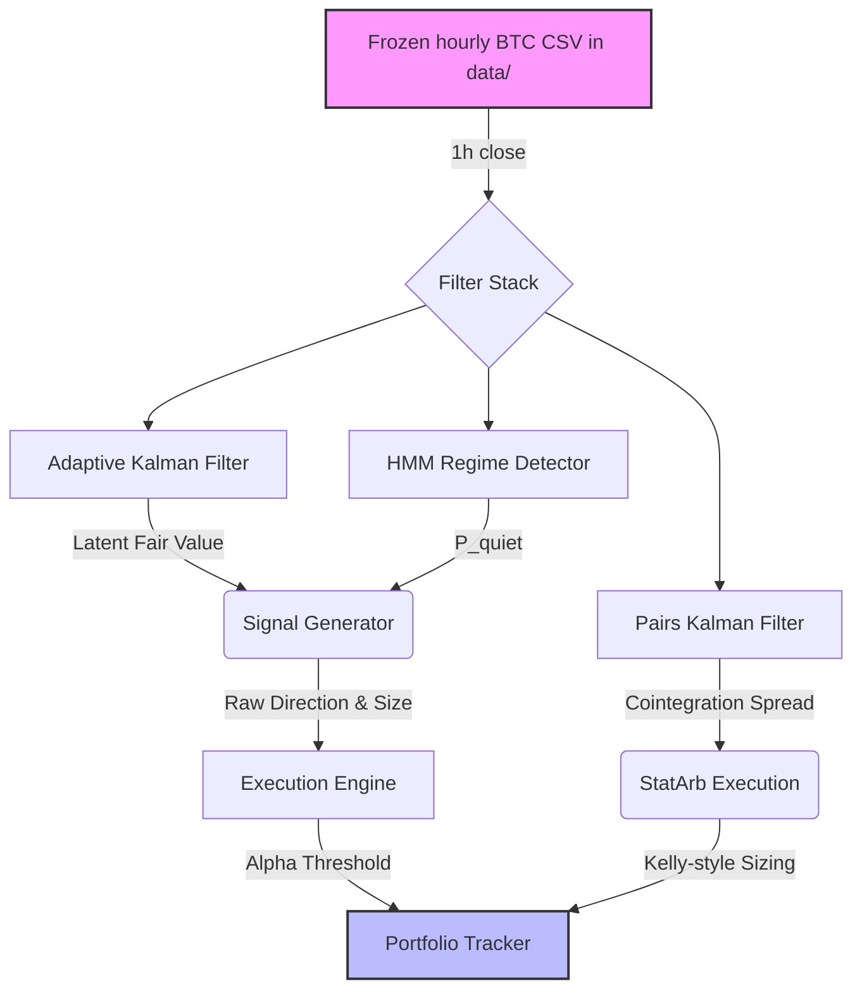

# Bayesian Market Filters

Kalman, particle and hidden Markov model filters for latent fair value and regime detection, with benchmark scripts on synthetic data and an exploratory bar-level backtest on one year of hourly BTC candles (frozen in `data/` for reproducibility).

**Status (audit, 2026-10-12): exploratory.** The backtest results below are produced by the code in this repo, but they rest on a fill assumption (every passive order fills at the bar close, which the code treats as the mid) that the data cannot support, and the positive out-of-sample results mostly disappear with one bar of execution delay. Read "Fill assumption" and "Limitations" before quoting any number.

## Final System Architecture

## Components
- **Synthetic data generator (`src/data/synthetic.py`)**: a hidden Ornstein-Uhlenbeck fair value with Markov regime switching and fat-tailed noise, used as a known-answer test bed for the filters.
- **Adaptive Kalman filter (`src/filters/kalman.py`)**: tracks latent fair value and drift; process and observation noise are updated online with a Robbins-Monro style rule.
- **Pairs Kalman filter (`src/filters/kalman.py`)**: tracks a time-varying intercept and hedge ratio between log BTC and log ETH.
- **Stochastic volatility particle filter (`src/filters/particle.py`)**: sequential importance resampling (default 5,000 particles; `notebook_03_backtest.py` uses 5,000). Note: in the backtest the particle filter is stepped but its output does not feed the signal (`notebook_03_backtest.py:75`; nothing reads `pf` afterwards).
- **Hidden Markov model (`src/filters/hmm.py`)**: 2-state regime model fit by Baum-Welch on the first half of the data only; the backtest uses the forward (filtering) probabilities, not smoothed ones.
- **ML overlay (`src/signals/ml_generator.py`)**: a scikit-learn gradient boosting classifier that maps four filter features to the sign of the next hourly return.
- **Kelly-style sizing (`notebook_05_multi_asset_statarb.py`)**: position = clip(z / 3, -1, 1) on the pairs spread z-score. This is a linear rule in the z-score, not a fitted Kelly fraction.

## Data

`data/btc_1h_2025_2026.csv` holds 8,760 hourly candles from 2025-06-30 10:00 UTC to 2026-07-07 09:00 UTC (sha256 `75532235...df8122e3`). Although the fetch code tries the Binance REST API first, the frozen file appears to come from the yfinance fallback (`src/data/market.py:35-54`, BTC-USD rather than Binance BTCUSDT): its timestamps carry a `+00:00` offset that the Binance branch (`market.py:73`) never writes, and 4,436 of the 8,760 rows have zero volume. There are no bid or ask prices in the data, only OHLCV.

## Backtest results (rerun 2026-10-12 on the frozen data)

Single split: first 4,380 hours in-sample (IS, 2025-06-30 to 2026-01-05), last 4,380 hours out-of-sample (OOS, 2026-01-05 to 2026-07-07). Sharpe is annualized from hourly net returns with sqrt(8760), risk-free rate 0. Hit rate is the share of in-market hours with a positive net return. Every number below is printed by the notebook scripts; the full output is in `audit/rerun_2026-10-12.txt`.

### In-Sample (first 6 months)
| Strategy | Sharpe Ratio | Max Drawdown | Hit Rate | Total Net PnL |
|----------|--------------|--------------|----------|---------------|
| **Naive (taker fee 5 bps)** | -1.76 | -22.70% | 44.56% | -19.71% |
| **Alpha Threshold (maker fee 1.5 bps)** | 0.00 | -10.32% | 48.35% | -1.22% |
| **ML overlay (maker fee 1.5 bps), training period** | +14.03 | -3.41% | 76.87% | +191.46% |
| **Exploratory StatArb (BTC/ETH, 1.5 bps per leg)** | -2.63 | -0.02% | N/A | -0.01% |

The ML overlay's in-sample row is its training fit (the classifier was trained on these hours), so it measures memorization, not performance.

### Out-Of-Sample (last 6 months)
| Strategy | Sharpe Ratio | Max Drawdown | Hit Rate | Total Net PnL |
|----------|--------------|--------------|----------|---------------|
| **Naive (taker fee 5 bps)** | -1.84 | -24.33% | 46.43% | -15.78% |
| **Alpha Threshold (maker fee 1.5 bps)** | +0.71 | -12.84% | 52.87% | +5.67% |
| **ML overlay (maker fee 1.5 bps)** | +2.33 | -9.67% | 55.81% | +30.58% |
| **Exploratory StatArb (BTC/ETH, 1.5 bps per leg)** | -5.02 | -0.34% | N/A | -0.34% |
| *Buy and hold BTC (no fees, for reference)* | -1.38 | | | -31.63% |

**Corrections made in this audit.** (1) An earlier version of this README gave the ML overlay's OOS Sharpe as +2.33 in the table and +2.09 in the note. The current code on the frozen data prints +2.33 (`notebook_04_ml_overlay.py:143`). The +2.09 came from commit `1a775a3`, which charged 0 bps on maker trades and fetched live data before the data were frozen; it cannot be reproduced from this repo and has been removed. (2) The Naive row previously read IS -3.96 / OOS -3.25; those were left over from a run on an earlier live-data window. The current code prints IS -1.76 / OOS -1.84 (`notebook_03_backtest.py:136-137`). (3) The note said the ML in-sample Sharpe was "> 15"; the current code prints +14.03. The Alpha Threshold and StatArb rows already matched the current code.

## Fill assumption (read this first)

The backtester has no order book, no quotes and no fill model. `Backtester.run` (`src/data/market.py:99-113`) does three things: it sets the held position to the previous bar's target (`market.py:101`), earns position times the close-to-close return (`market.py:105-106`), and subtracts a flat fee times the absolute position change (`market.py:110-111`). So every trade executes in full, at the same hourly close the signal was computed from, with no spread, no queue and no adverse selection. The code passes that close in as `mid_price` (`notebook_03_backtest.py:70,82,102`; `notebook_04_ml_overlay.py:64,115`), which is why this README previously said "fills at the mid".

"Maker" in the tables means only that the fee is 1.5 bps instead of 5 bps (`notebook_03_backtest.py:121`, `notebook_04_ml_overlay.py:127`). A real passive order is not guaranteed to fill, and it tends to fill when the price is moving against it. Neither effect is modelled, so the maker rows are an upper bound, not an estimate. The Alpha Threshold gate itself (`src/execution/engine.py:33`) compares the mispricing to a 5 bps spread plus a 5 bps taker fee, which is a different cost than the 1.5 bps the backtest then charges.

## Audit sensitivity checks

`audit/audit_diagnostics.py` rebuilds the notebook signal paths unchanged, confirms it reproduces the OOS rows above, and varies one assumption at a time. Output: `audit/audit_diagnostics_output.txt`.

OOS Sharpe by cost per unit of position change:

| Cost (bps) | Alpha Threshold | ML overlay |
|-----------|-----------------|------------|
| 0 (frictionless) | +1.71 | +3.23 |
| 1.5 (README maker) | +0.71 | +2.33 |
| 5 (README taker) | -1.61 | +0.20 |
| 10 (taker plus an assumed 5 bps half-spread) | -4.88 | -2.82 |

- **One bar of extra execution delay** (trade at the next hourly close instead of the signal bar's close, 1.5 bps): Alpha Threshold OOS Sharpe falls from +0.71 to -0.34, ML overlay from +2.33 to +0.22. Most of the measured edge sits in the first hour after the signal, which is where the fill-at-the-close assumption matters most.
- **Statistical uncertainty** (6 months, 4,380 hourly returns): the approximate standard error of an annualized Sharpe is 1.41, so +2.33 is about 1.6 standard errors from zero and +0.71 about 0.5. A moving-block bootstrap (24 h blocks, 2,000 resamples) gives 95% intervals of [-0.11, +4.78] for the ML overlay and [-2.38, +3.71] for Alpha Threshold. Neither is distinguishable from zero at the 5% level.
- **Exposure**: the ML overlay is in the market 731 of 4,380 OOS hours (487 long, 244 short) with 703 position changes; fees take 11.01 percentage points of 39.15 points of summed gross return.

## StatArb note

The BTC/ETH pairs strategy loses money in both halves. Its positions are tiny (max drawdown 0.34%) because the z-score divides the filter's post-update residual by the pre-update innovation standard deviation (`notebook_05_multi_asset_statarb.py:60-74`, `src/filters/kalman.py:200-207`), which keeps the z-score small. `scripts/diagnose_statarb.py` reports ADF statistics of -8.19 (IS) and -12.67 (OOS) on that residual, but a residual from a filter whose intercept and hedge ratio re-estimate every hour will look stationary almost by construction, so this is not evidence that BTC and ETH are cointegrated. The script also needs `statsmodels`, which is not in `requirements.txt`.

## Limitations

- **Fills**: 100% fill at the hourly close, no spread, no queue, no adverse selection (see "Fill assumption"). The data have no bid or ask, so the true cost of trading cannot be measured here.
- **Execution timing**: trades execute at the same close the signal is computed from. One bar of delay removes most of the OOS result.
- **Sample**: one asset, one year, one 50/50 split, about 700 to 1,100 OOS position changes. No walk-forward re-fitting despite the earlier "walk-forward" label: the HMM and the classifier are fit once on the first half and frozen.
- **Regime**: BTC fell 31.63% over the OOS half and 14.09% over the IS half; the strategies were never tested in a rising market.
- **Out-of-sample hygiene**: the OOS half was viewed repeatedly while the strategy was being built. The macro trend filter was added with a script that printed the OOS Sharpe (`test_macro.py`, deleted in commit `43c70cf`), and the README OOS numbers changed across several commits as fees, filters and the data window changed. The final parameters (`base_spread=0.0005`, `variance_threshold=500.0`) lie outside the in-sample grid that `grid_search.py` searched, so their origin is not documented.
- **Data source**: the frozen CSV appears to be yfinance BTC-USD rather than Binance BTCUSDT, and half its rows have zero volume.
- **Tests**: `tests/test_bt.py` fails at collection (it reads a file that does not exist); the other 12 tests pass.
- **Reproducibility**: results are pinned to the committed CSVs; rerunning the fetch code against live data will give different numbers.

## Notebooks
- `notebook_01_kalman.ipynb`: Kalman filter derivation and confidence band plots.
- `notebook_02_hmm.ipynb`: forward-backward and Baum-Welch derivations and regime plots.
- `notebook_03_backtest.ipynb` / `.py`: Naive and Alpha Threshold backtest.
- `notebook_04_ml_overlay.ipynb` / `.py`: gradient boosting overlay backtest.
- `notebook_05_multi_asset_statarb.ipynb` / `.py`: pairs Kalman filter and Kelly-style sizing for BTC/ETH.
